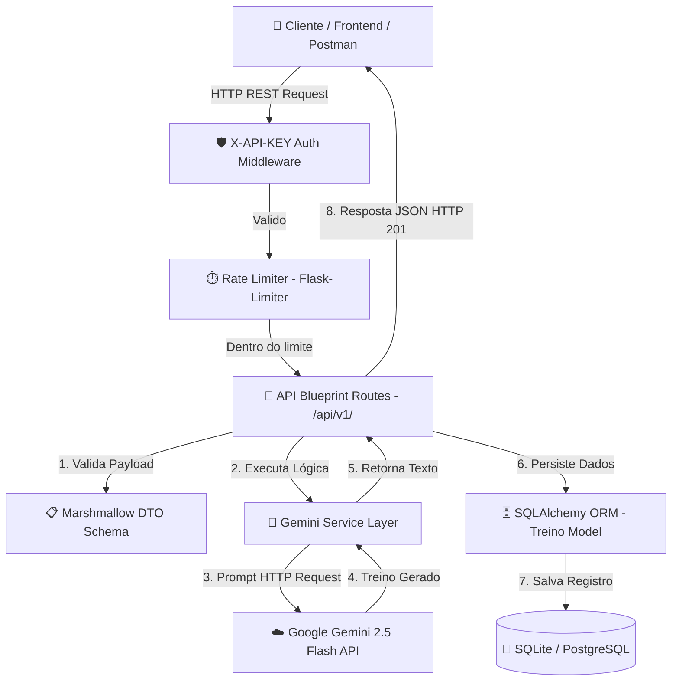

# 🏋️ API de Treinos com IA e Persistência de Dados

<p align="center">
  
  
  
  
  
  
</p>

---

## 📌 Visão Geral do Projeto

A **API de Treinos com IA** é uma solução backend robusta, escalável e pronta para produção desenvolvida em **Python** utilizando **Flask** e integrada ao modelo de inteligência artificial de última geração **Google Gemini 2.5 Flash**.

A aplicação permite a geração dinâmica de planos de treino personalizados com base em objetivos fitness e níveis de experiência do usuário, armazenando os treinos gerados em um banco de dados relacional (**SQLite** por padrão ou **PostgreSQL** para produção).

---

## 🏗️ Arquitetura do Sistema

A aplicação adota o padrão **Application Factory** e arquitetura em camadas (**Clean Architecture / Layered Architecture**), separando claramente rotas (controllers), modelos (ORM), validações (schemas DTO) e serviços externos de IA.



---

## ✨ Destaques de Engenharia e Boas Práticas

- **Padrão Application Factory**: Instanciação limpa e configurável do Flask app para desenvolvimento, testes e produção.
- **Validação Estrita de DTOs**: Garantida pelo **Marshmallow**, impedindo requisições malformadas antes de processar a IA.
- **Proteção contra Abuso (Rate Limiting)**: Limite configurável por IP (padrão 5 req/min no endpoint de IA) via **Flask-Limiter**.
- **Autenticação Flexível**: Decorator `@require_api_key` que valida o cabeçalho `X-API-KEY` (desativável em desenvolvimento local).
- **CORS Habilitado**: Configuração nativa via **Flask-CORS** para integrar com frontends React, Next.js, Vue ou aplicativos mobile.
- **Suíte de Testes Automatizados**: Cobertura Pytest completa com **mocks** do serviço de IA (sem dependência de cota ou chamadas externas no CI).
- **Integração Contínua (CI/CD)**: Pipeline no **GitHub Actions** automatizando execução de testes e linter **Flake8**.
- **Containerização com Docker**: Imagem leve baseada em `python:3.11-slim` utilizando **Gunicorn** como servidor WSGI de produção.

---

## 📂 Estrutura do Repositório

```text
API_Treino/
├── .github/
│   ├── ISSUE_TEMPLATE/       # Templates para reporte de bugs e sugestões
│   ├── PULL_REQUEST_TEMPLATE.md
│   └── workflows/
│       └── ci.yml            # Pipeline do GitHub Actions (Lint & Pytest)
├── api_academia/             # Pacote principal da aplicação
│   ├── __init__.py           # Application Factory e registro de extensões
│   ├── auth.py               # Decorator de segurança X-API-KEY
│   ├── config.py             # Carregamento de variáveis de ambiente
│   ├── database.py           # Instância singleton do SQLAlchemy
│   ├── limiter.py            # Instância do Flask-Limiter
│   ├── models.py             # Modelo SQLAlchemy (Entidade Treino)
│   ├── routes.py             # Controllers e Endpoints RESTful (/api/v1)
│   ├── schemas.py            # Schemas Marshmallow de validação/serialização
│   └── services.py           # Camada de Serviço (Integração Google GenAI)
├── tests/                    # Suíte de testes automatizados com Pytest
│   ├── conftest.py           # Fixtures do Pytest e mock da IA Gemini
│   ├── test_auth_and_limiter.py
│   ├── test_health.py
│   └── test_treinos.py
├── .env.example              # Modelo de variáveis de ambiente
├── .gitignore                # Arquivos ignorados pelo Git
├── app.py                    # Ponto de entrada WSGI / Execução local
├── CONTRIBUTING.md           # Guia de contribuição e convenção de commits
├── Dockerfile                # Configuração para deploy em container
├── LICENSE                   # Licença MIT
├── Makefile                  # Atalhos de comandos (install, test, run, lint)
├── pyproject.toml            # Configuração unificada do Pytest e Flake8
├── README.md                 # Documentação principal do projeto
├── requirements.txt          # Dependências do projeto e de testes
└── run_tests.py              # Script executável para rodar a suíte de testes
```

---

## 🚀 Como Executar o Projeto

### 1. Pré-requisitos
- **Python 3.11+**
- **Git**
- **Docker** *(opcional para execução em container)*

---

### 2. Instalação e Execução Local

```bash
# 1. Clone o repositório
git clone https://github.com/SeuUsuario/API_Treino.git
cd API_Treino

# 2. Crie e ative o ambiente virtual
python -m venv .venv

# No Windows (PowerShell):
.\.venv\Scripts\Activate.ps1
# No Linux/Mac:
source .venv/bin/activate

# 3. Instale as dependências
pip install -r requirements.txt
# Ou utilizando o Makefile:
make install

# 4. Configure o arquivo de variáveis de ambiente
cp .env.example .env
```

Edite o arquivo `.env` e preencha sua chave do Google Gemini:
```env
GEMINI_API_KEY=sua_chave_obtida_no_google_ai_studio
```

Inicie o servidor de desenvolvimento:
```bash
python app.py
# Ou via Makefile:
make run
```
A API estará acessível em: `http://localhost:5000`

---

### 3. Execução com Docker

```bash
# Construir a imagem Docker
docker build -t api-academia:latest .

# Rodar o container na porta 5000
docker run -p 5000:5000 --env-file .env api-academia:latest
```

---

## 🧪 Testes Automatizados e Qualidade de Código

O projeto conta com suíte de testes utilizando **Pytest** e **pytest-mock**:

```bash
# Executar todos os testes com relatório de cobertura
pytest --cov=api_academia tests/

# Ou utilizando o script utilitário:
python run_tests.py

# Verificar padrão de código com Flake8
flake8 .
```

---

## 📡 Documentação dos Endpoints RESTful

Todos os endpoints estão sob o prefixo `/api/v1`.

| Método | Endpoint | Descrição | Requer X-API-KEY |
| :--- | :--- | :--- | :---: |
| `GET` | `/` | Informações e status da API | Não |
| `GET` | `/api/v1/health` | Health Check do servidor | Não |
| `POST` | `/api/v1/treino` | Gera treino via IA Gemini e salva no DB | Sim (se configurado) |
| `GET` | `/api/v1/treinos` | Lista todos os treinos armazenados | Sim (se configurado) |
| `GET` | `/api/v1/treino/<id>` | Busca um treino específico por ID | Sim (se configurado) |
| `DELETE` | `/api/v1/treino/<id>` | Remove um treino do banco por ID | Sim (se configurado) |

---

### Exemplos de Requisições (cURL)

#### 1. Criar um Novo Treino (POST)
```bash
curl -X POST http://localhost:5000/api/v1/treino \
  -H "Content-Type: application/json" \
  -H "X-API-KEY: sua_chave_se_configurada" \
  -d '{
    "objetivo": "Hipertrofia de peitoral e tríceps",
    "nivel": "intermediario"
  }'
```

**Exemplo de Resposta (HTTP 201 Created):**
```json
{
  "id": 1,
  "objetivo": "Hipertrofia de peitoral e tríceps",
  "nivel": "intermediario",
  "treino_gerado": "### Treino de Peitoral e Tríceps - Nível Intermediário\n\n1. **Supino Reto com Barra** - 4 séries de 10 repetições\n2. **Supino Inclinado com Halteres** - 3 séries de 12 repetições\n3. **Tríceps Teste** - 3 séries de 12 repetições",
  "criado_em": "2026-09-12T18:30:00Z"
}
```

#### 2. Listar Todos os Treinos (GET)
```bash
curl -X GET http://localhost:5000/api/v1/treinos \
  -H "X-API-KEY: sua_chave_se_configurada"
```

#### 3. Obter Treino por ID (GET)
```bash
curl -X GET http://localhost:5000/api/v1/treino/1 \
  -H "X-API-KEY: sua_chave_se_configurada"
```

#### 4. Deletar Treino por ID (DELETE)
```bash
curl -X DELETE http://localhost:5000/api/v1/treino/1 \
  -H "X-API-KEY: sua_chave_se_configurada"
```

---

## 📜 Licença

Este projeto está sob a licença [MIT](LICENSE).

---

<p align="center">
  Desenvolvido por <strong>Caio Souza</strong> 🚀
</p>
